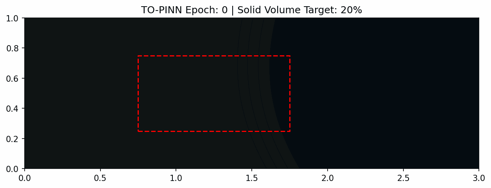

# TO-PINN: Unsupervised Aerodynamic Topology Optimization

*Autonomous evolution of a low-drag aerodynamic profile over 8,000 epochs, strictly driven by Navier-Stokes physics.*

##  Project Overview
This project implements a **Topology Optimization Physics-Informed Neural Network (TO-PINN)** that acts as an autonomous aerodynamic architect. 

Instead of training an AI on thousands of pre-computed CFD simulations, this model designs its own geometries from scratch. By placing a raw block of material into a virtual fluid flow ($Re = 30$) and mathematically penalizing energy dissipation (drag), the neural networks carve out an optimized, teardrop airfoil shape entirely on their own.

##  Why This is Significant (The Relevance)
Traditional Deep Learning in fluid dynamics relies heavily on massive datasets generated by expensive solvers like OpenFOAM. This project proves that we can achieve complex inverse design with a **fully unsupervised, zero-data** approach.

**Key Engineering Accomplishments:**
* **Defeated "Trivial Collapse":** A common failure in PINN topology optimization is the AI simply deleting all solid material so the fluid encounters zero resistance. I engineered a novel **Two-Phase Training Architecture** to lock the physics in place before allowing the AI to sculpt.
* **Strict Boundary Adherence:** Implemented an `L_Outside` "electric fence" penalty to perfectly quarantine the AI's geometry generation to a specific design box, preventing chaotic, out-of-bounds pixel generation.
* **Dynamic Solid-Fluid Boundary:** Eliminated the need for expensive mesh generation by implementing continuous **Brinkman Penalization**, representing solid material as a continuous density field.

##  Tools & Technologies Used
* **Framework:** PyTorch (Leveraging 2nd-order Autograd for continuous PDE differentials)
* **Compute / Hardware:** NVIDIA T4 GPU (via Kaggle)
* **Mathematics:** Navier-Stokes Equations, Brinkman Penalization, Multi-objective Gradient Optimization
* **Visualization:** Matplotlib, NumPy, ImageIO

##  How It Works (The Architecture)
1. **Phase 1 (Warmup):** The Geometry Network is restricted and forced to output a square block. The Flow Network learns the complex physics of fluid crashing into this block.
2. **Phase 2 (Sculpting):** The Geometry Network is unfrozen. Bound by a strict 20% volume constraint, it begins shaving off high-drag corners to minimize global dissipation. The two networks optimize cooperatively, resulting in a naturally aerodynamic profile.

##  Repository Structure
* `assets/`: Contains the training evolution GIF and high-res final epoch output.
* `notebooks/`: Contains the complete, reproducible Kaggle notebook (`to_pinn_kaggle_t4.ipynb`).
* `src/`: Core Python modules (Networks, Physics penalties, and the Training loop).
